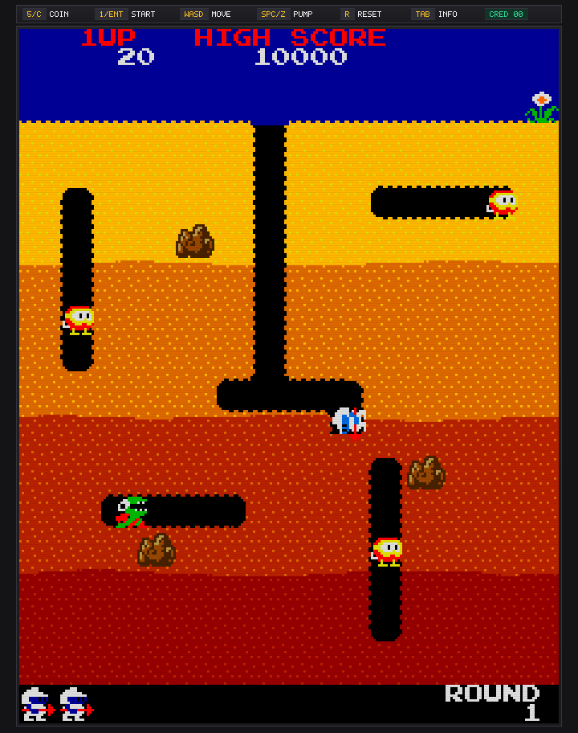
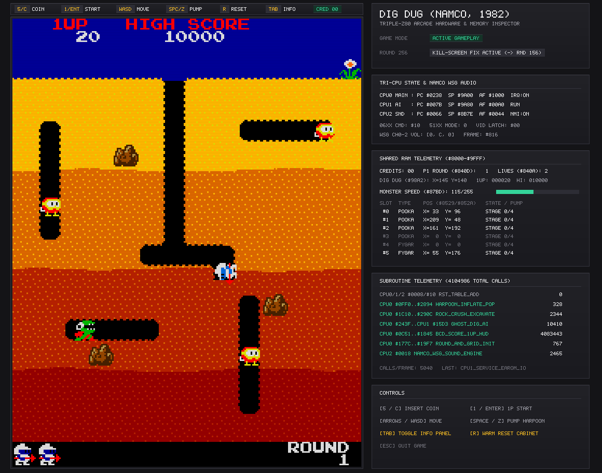

# Dig Dug (1982) — Rust Decompilation & Arcade Hardware Implementation

A reverse-engineering and native Rust decompilation of Namco's **Dig Dug** (1982, Rev 2) triple-Z80 arcade hardware.

All executable code across all three Z80 processors (`CPU 0` Main Game, `CPU 1` Monster & Sprite AI, and `CPU 2` Sound Sequencer) has been translated into Rust ([`src/decomp.rs`](src/decomp.rs)) and paired with Namco custom silicon emulation (`06XX`, `51XX`, `53XX`, non-volatile `ER2055` high-score EAROM, and 120 Hz 3-channel Namco WSG wavetable audio).

<p align="center">
  
  &nbsp;&nbsp;
  
</p>

---

## Controls

| Key | Action |
| :--- | :--- |
| **`5`** or **`C`** | Insert Coin |
| **`1`** or **`Enter`** | Start 1-Player Game |
| **`Arrow Keys`** or **`WASD`** | Move Dig Dug (4-way arcade priority) |
| **`Space`**, **`Z`**, or **`Left Ctrl`** | Fire / Pump Harpoon |
| **`Tab`** | Toggle Live Hardware & Memory Inspector Panel |
| **`R`** | Warm Reset Arcade Cabinet |
| **`Esc`** | Quit |

---

## ROM Setup (Required at Runtime)

> **Note:** No copyrighted ROM or PROM data is included in this repository or embedded in compiled binaries. You must supply your own legally obtained **Dig Dug (Rev 2)** arcade ROM set.

You can provide the ROMs in either of two ways:

1. **Drop in `digdug.zip` directly:** Place your MAME `digdug.zip` archive in the project root (or in the same folder as the `digdug` executable). On first launch, it will automatically extract the required ROM chips into `roms/extracted/`.
2. **Pre-extracted directory:** Extract your Dig Dug ROM/PROM files into `roms/extracted/` at the root of the repository (or next to the `digdug` executable):

```text
roms/extracted/
├── dd1a.1       (4096 bytes) - CPU 0 Main Program ROM 0 ($0000-$0FFF)
├── dd1a.2       (4096 bytes) - CPU 0 Main Program ROM 1 ($1000-$1FFF)
├── dd1a.3       (4096 bytes) - CPU 0 Main Program ROM 2 ($2000-$2FFF)
├── dd1a.4       (4096 bytes) - CPU 0 Main Program ROM 3 ($3000-$3FFF)
├── dd1a.5       (4096 bytes) - CPU 1 Sub/AI ROM 0 ($0000-$0FFF)
├── dd1a.6       (4096 bytes) - CPU 1 Sub/AI ROM 1 ($1000-$1FFF)
├── dd1.7        (4096 bytes) - CPU 2 Sound ROM ($0000-$0FFF)
├── dd1.9        (2048 bytes) - Foreground 8x8 1bpp Character/HUD Tiles
├── dd1.10b      (4096 bytes) - Playfield Dirt Tilemap Lookup ROM
├── dd1.11       (4096 bytes) - Background 8x8 2bpp Dirt Tiles
├── dd1.12       (4096 bytes) - 16x16 2bpp Sprite Graphics 3
├── dd1.13       (4096 bytes) - 16x16 2bpp Sprite Graphics 2
├── dd1.14       (4096 bytes) - 16x16 2bpp Sprite Graphics 1
├── dd1.15       (4096 bytes) - 16x16 2bpp Sprite Graphics 0
├── 136007.110   ( 256 bytes) - Namco WSG 8x32 4-bit Sound Wavetable PROM
├── 136007.111   ( 256 bytes) - Sprite Color Lookup Table (CLUT) PROM
├── 136007.112   ( 256 bytes) - Background Tile CLUT PROM
└── 136007.113   (  32 bytes) - Master 32-Entry RGB Resistor-Network Palette PROM
```

Even though all Z80 program logic runs natively in Rust, these files are read at startup for sprite/tile bitmaps, color PROM lookup tables, WSG audio waveforms, and stage/music data tables.

---

## Building & Running

### Run the Arcade Cabinet Window
```powershell
cargo run --release --bin digdug
```
*(Once built, you can also double-click `target\release\digdug.exe` directly in Windows Explorer.)*

### Run Automated Headless Verification
Simulates 700 frames of coin insertion, 1P start, opening fanfare, tunnel digging, harpoon firing, and 120 Hz dual-tick WSG audio verification:
```powershell
cargo run --release --bin digdug -- --headless-test
```

---

## Architecture & Source Layout

| File | Description |
| :--- | :--- |
| [`src/main.rs`](src/main.rs) | Window creation, keyboard input polling, 60 Hz frame pacing, and `--headless-test` runner |
| [`src/hardware.rs`](src/hardware.rs) | Triple-CPU scheduler (`CPU 0`, `CPU 1`, `CPU 2`), shared 8 KB RAM (`$8000-$9FFF`), and Namco `06XX`/`51XX`/`53XX` custom I/O chips |
| [`src/decomp.rs`](src/decomp.rs) | Human-decompiled Rust implementations of all CPU 0, CPU 1, and CPU 2 routines (`step_human_cpu0`, `step_human_cpu1`, `step_human_cpu2`) and `GameStateSnapshot` |
| [`src/video.rs`](src/video.rs) | Upright `224x288` CRT scanline renderer (36x28 tilemap + 64 hardware sprites in `16x16`/`32x32` flip modes), top control bar, and `[Tab]` hardware/memory inspector |
| [`src/audio.rs`](src/audio.rs) | Real-time 44.1 kHz 3-channel Namco WSG wavetable synthesizer driven by dual 120 Hz sub-frame register snapshots |
| [`src/rom.rs`](src/rom.rs) | Runtime loader, `digdug.zip` auto-extractor, and ROT90 tile/sprite/PROM decoder |
| [`src/z80.rs`](src/z80.rs) | Z80 register file, ALU flag helpers, and `Z80Bus` trait |
| [`src/bin/analyze.rs`](src/bin/analyze.rs) | Control-flow analyzer that generates annotated Z80 listings and the reverse-engineering report |
| [`disasm/REVERSE_ENGINEERING_REPORT.md`](disasm/REVERSE_ENGINEERING_REPORT.md) | Reverse-engineered memory map (`$6800-$B840`), hardware register reference, and Round 256 kill-screen analysis |

---

## License

Released under the [MIT License](LICENSE).

